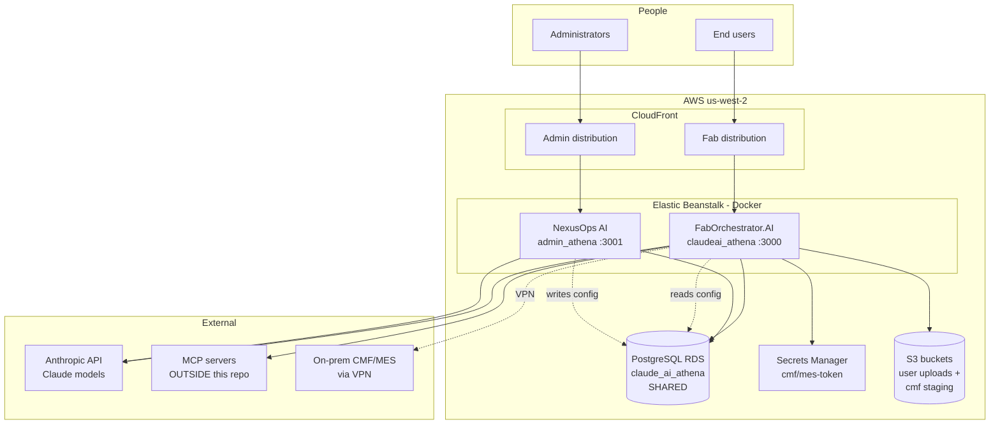
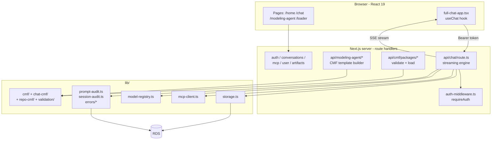
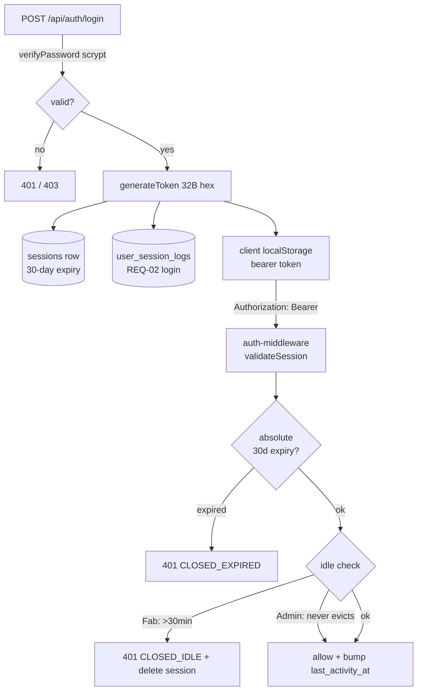

# 4 — Architecture, Diagrams & Fab↔Admin Integration

> Version: commit `7976c78` on `main`. See [README](./README.md).
> Validation: 🔵 Static. Diagrams are drawn from the code and schema; verify against a
> running system. Diagrams use **Mermaid** (renders automatically on GitHub).

---

## 4.1 Overall system

Two Next.js apps, **one shared PostgreSQL database**, several external systems. The Fab
app is the only one that reaches the factory network.



**Key facts encoded above:**
- Both apps depend on the **same RDS database** — this is how they integrate (§4.4).
- Only **Fab** talks to S3, Secrets Manager, MCP servers, and the on-prem **CMF/MES** (over VPN).
- Both apps call the **Anthropic API** for their respective chat features.
- **MCP servers and the CMF/MES system are external** — not in this repo.

---

## 4.2 Fab app internal architecture



The **chat route is the core**; the **CMF/modeling subsystem** is a large, separate
surface. Both go through `auth-middleware` and share `storage.ts` + the audit libs.

---

## 4.3 Admin app internal architecture

```mermaid
flowchart TB
    subgraph client[Browser]
        APAGES[Pages: /admin +<br/>users roles models<br/>mcp usage audit]
        ACHAT[admin/chat/page.tsx<br/>useChat]
    end

    subgraph server[Route handlers]
        AADMIN[auth-middleware.ts<br/>requireAdmin]
        ACHATR[api/admin/chat/route.ts<br/>+ admin-tools.ts ~30 tools]
        ACRUD[api/admin/users|roles|<br/>model-registry|mcp|usage|<br/>audit-logs|compliance]
    end

    subgraph svc[lib/services/ - shared core]
        USVC[admin-user-service]
        RSVC[role-service]
        ISVC[invitation-service]
        AUSVC[audit-service]
    end

    ACHAT -->|Bearer| ACHATR
    APAGES --> ACRUD
    ACHATR --> AADMIN
    ACRUD --> AADMIN
    ACHATR --> svc
    ACRUD --> svc
    svc --> DB[(RDS)]
    ACHATR -. raw SQL audit .-> DB
```

**The defining pattern:** the admin app can be driven by **either** clicking a page
**or** telling the AI chat. Both paths call the **same `lib/services/*`** core, so behavior
is identical. (Caveat: a few chat tools bypass the service layer — see
[hotspots §4](./03-review-hotspots.md#4-data-integrity--destructive-actions).)

---

## 4.4 Fab ↔ Admin integration — via the shared database

> **This is the single most important integration fact, and it corrects the assignment's
> assumed diagram.** The two apps **do not call each other over the network.** There is no
> Admin→Fab API request. They integrate **only through shared tables** in the one RDS
> database: Admin **writes** configuration, Fab **reads** it.

```mermaid
flowchart LR
    subgraph ADM[NexusOps AI - Admin]
        AW[Admin writes config]
    end
    subgraph DB[(Shared PostgreSQL)]
        T1[roles<br/>allowedModels, limits, permissions]
        T2[model_registry<br/>models + USD pricing]
        T3[mcp_registry + mcp_connections<br/>tool access]
        T4[platform_settings<br/>color theme]
        T5[users<br/>status, isAdmin, forcePasswordChange]
        T6[audit tables<br/>usage, sessions, errors, prompts]
    end
    subgraph FAB[FabOrchestrator.AI - Fab]
        FR[Fab reads config<br/>+ writes audit/usage]
    end

    AW --> T1 & T2 & T3 & T4 & T5
    T1 & T2 & T3 & T4 & T5 --> FR
    FR --> T6
    T6 --> AW
```

| What Admin controls | Table(s) | How Fab uses it |
|---------------------|----------|-----------------|
| Which models exist + pricing | `model_registry` | Fab's model picker, RBAC gate, USD cost math |
| Role permissions / model access / daily limits | `roles` | Fab's chat route gates every request |
| MCP tools available to a role/user | `mcp_registry`, `mcp_connections` | Fab loads authorized MCP tools into chat |
| Platform color theme | `platform_settings` | Fab reads via `/api/platform-theme` |
| User status / suspend / force-reset | `users` | Fab's `auth-middleware` blocks suspended users |
| Usage, sessions, errors, prompts (audit) | `usage_records`, `user_session_logs`, `error_audit_logs`, `prompt_audit_logs` | **Fab writes**, Admin reads & reports |

**Consequences worth documenting:**
- **Loose coupling.** Either app can be deployed/restarted independently; they only need
  the DB. But a **schema change is a cross-app contract** — the reason `schema.prisma`
  is a declared single source of truth mirrored into Fab.
- **No shared session.** Logging into Admin does not log you into Fab; each app issues its
  own bearer token. A user with `isAdmin` can use both, but must log in to each.
- **Config propagation is eventually-consistent**, gated by cache TTLs (e.g. model
  registry ~60s, error catalog ~60s). An admin edit isn't instant in Fab.

---

## 4.5 Authentication & session model (both apps)



- **Bearer tokens in `localStorage`, no cookies.** Same mechanism both apps.
- **Fab idle-evicts at 30 min; Admin never idle-evicts** (but records idle history and
  reconciles *end-user* sessions when an admin queries).
- Full login walkthrough: [scenario 01](./scenarios/01-login.md).

---

## 4.6 Data model overview

The shared schema (`admin_athena/prisma/schema.prisma`) groups into:

| Group | Tables |
|-------|--------|
| Identity / RBAC | `roles`, `users`, `sessions`, `invitations`, `password_reset_tokens` |
| Chat | `conversations`, `messages`, `artifacts`, `mcp_connections`, `memory_files` |
| Admin-managed config | `model_registry`, `mcp_registry`, `platform_settings` |
| Audit / usage (Prisma models) | `audit_logs`, `user_session_logs`, `usage_records` |
| Audit (raw-SQL only, **not in schema.prisma**) | `error_catalog`, `error_audit_logs`, `prompt_audit_logs`, `*_daily_counter` |
| CMF loader | `cmf_packages`, `cmf_staged_uploads`, `cmf_package_files`, `cmf_validation_reports`, `cmf_runs` |

> ⚠️ The **four raw-SQL audit tables are not represented in the Prisma schema** — they exist
> only via the additive SQL migrations and are accessed with `$queryRawUnsafe`. A reader of
> `schema.prisma` alone will not see them. (See [hotspots §5](./03-review-hotspots.md#5-raw-sql--injection-surface).)
