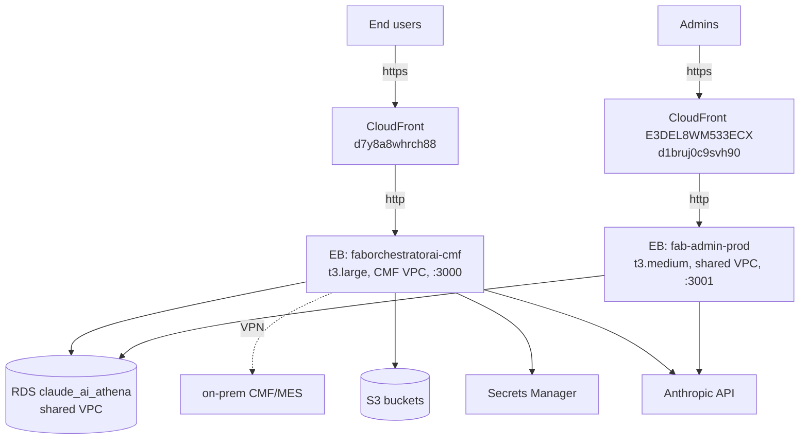
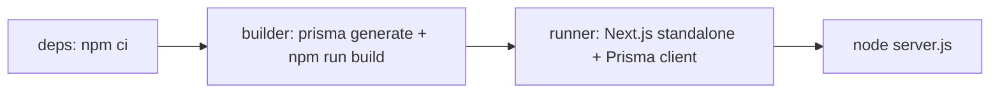
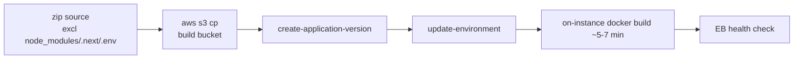

# 5 — Deployment, Infrastructure & CI/CD

> Version: commit `7976c78` on `main`. See [README](./README.md).
> Validation: 🔵 Static — from `cloudformation/*`, both `DEPLOYMENT.md`, `Dockerfile`,
> `buildspec.yml`, `.ebextensions/*`, `.platform/*`. Confirm live values with an ops owner.

> **Scope note:** There are **no GitHub Actions and no Terraform** in this repo. CI is **AWS
> CodeBuild** (`buildspec.yml`); IaC is **CloudFormation** (Terraform was retired in commit
> `90633e2`). Deploys are **manual** (zip → S3 → Elastic Beanstalk). See
> [scope §0.2](./00-phase-0-scope-and-inventory.md#02-scope-reconciliation).

---

## 5.1 Topology

AWS account `628203515088`, region `us-west-2`.



- **Fab** runs inside the **CMF VPC** (VPN to on-prem MES + VPC-peering to RDS).
- **Admin** runs in the **shared VPC** (RDS reads only; no CMF access).
- Both are **Docker on Elastic Beanstalk** (Amazon Linux 2023), fronted by **CloudFront** for HTTPS/SSE.

## 5.2 CloudFormation stacks (`cloudformation/`)

| Stack | File | Status | Purpose |
|-------|------|--------|---------|
| Networking | `networking.yaml` | reference only (mixes non-importable types) | CMF VPC app subnets, egress SG, VPC peering, RDS ingress |
| IAM | `iam.yaml` | **live** | `cmf-loader-access` managed policy (S3 + Secrets Manager) |
| Elastic Beanstalk | `elasticbeanstalk.yaml` | reference/parity | Fab + Admin EB app/env definitions |
| CloudFront (admin) | `cloudfront-admin.yaml` | **live** (imported, `DeletionPolicy: Retain`) | Admin HTTPS distribution `E3DEL8WM533ECX` |

Two usage modes: **create** (`aws cloudformation deploy`) for a fresh account, **import**
(`create-change-set --change-set-type IMPORT`) to adopt existing resources.

## 5.3 Build (Docker + CodeBuild)

Both apps share a **3-stage Docker build** on `node:22-alpine` (Node 22 required — a dep needs `util.markAsUncloneable`):



- **Fab** runtime `PORT=3000`, `EXPOSE 3000`.
- **Admin** runtime `PORT=3001`, bakes `NEXT_PUBLIC_ATHENA_URL`, dummy `DATABASE_URL` in deps stage.
- `buildspec.yml` (CodeBuild v0.2) is the **legacy App Runner path**: ECR login → `docker build` → push to ECR (`llmatscale-ai` / `nexusops-ai`) → `imageDetail.json`. App Runner is **decommissioned** (its 120s timeout broke SSE); the current flow is manual EB below.

## 5.4 Deploy (manual, per `DEPLOYMENT.md`)



- Fab EB app `faborchestratorai`, env `faborchestratorai-cmf` (live), rollback env `faborchestratorai-prod`. Blue/green via `swap-environment-cnames` (EB env VPC is immutable).
- Admin EB app `fab-admin`, env `fab-admin-prod`.
- Deploy buckets: `faborchestratorai-build-628203515088`, `fab-admin-build-628203515088`.
- **Migrations are NOT run by deploy** — the additive SQL (`admin_athena/prisma/*.sql`) and `prisma db push` are applied manually.

## 5.5 Runtime config that is load-bearing

| Setting | Value | Why |
|---------|-------|-----|
| `process:default` Port | **80** | ALB → Nginx. Wrong value = 502. |
| Container `PORT` | 3000 (Fab) / **3001 (Admin)** | Wrong value = every request 502s. |
| ALB `IdleTimeout` | **600s** | SSE streams exceed default 60s. |
| Nginx | `proxy_buffering off`, `proxy_read/send_timeout 600` | Streaming. |
| CloudFront `OriginReadTimeout` | 60s | ⚠️ SSE idle > 60s gets cut — the 15s keepalive in the chat route mitigates this. |
| `NODE_OPTIONS` | `--max-old-space-size` (6144 Fab / 3072–4096 Admin) | Memory. (Note: `.ebextensions` uses 6144 for both — minor inconsistency to confirm.) |

## 5.6 Secrets / environment (names only — never committed)

Set out-of-band on the EB environment (`aws:elasticbeanstalk:application:environment`).

| App | Keys |
|-----|------|
| Both | `ANTHROPIC_API_KEY`, `DATABASE_URL`, `KEY_ENCRYPTION_SECRET` (64-hex), `APP_URL`, `SMTP_*`, `NODE_ENV`, `PORT`, `NODE_OPTIONS` |
| Admin extra | `ATHENA_URL`, `NEXT_PUBLIC_ATHENA_URL`, `ADMIN_EMAIL/PASSWORD/NAME` |
| Fab extra (CMF) | `CMF_BASE_URL`, `CMF_TLS_INSECURE`, `HOST_RESOLVER`, `CMF_SQL_*`, `CMF_TOKEN_SECRET_ID=cmf/mes-token`, `CMF_TOKEN_REGION`, `AWS_REGION`, `S3_BUCKET`, `S3_UPLOAD_BUCKET`, `S3_PRESIGN_TTL_SECONDS`, optional `CHAT_LLM_MODEL`/`VALIDATION_LLM_MODEL` |

## 5.7 IAM

Shared EB instance role `aws-elasticbeanstalk-ec2-role` + managed policy **`cmf-loader-access`** granting:
- S3 `Get/Put/Delete/ListBucket` on `cmf-loader-uploads-628203515088` + `faborch-user-uploads`.
- `secretsmanager:GetSecretValue` on `cmf/mes-token-*`.

## 5.8 Deployment "scenario" (developer → running service)

```
Developer commits to main
  → (build image) CodeBuild `buildspec.yml`  [legacy ECR path]  — OR —
  → (current) zip source → s3 cp → create-application-version → update-environment
  → EB builds Docker image on-instance (~5-7 min)
  → Nginx:80 → container (3000/3001)
  → EB enhanced health check
  → CloudFront serves HTTPS
Rollback: swap-environment-cnames back to the previous env
```

## 5.9 Open items for an ops owner

- [ ] Confirm the **live** deploy method (CodeBuild/ECR vs manual zip→EB) — both exist; docs say manual is current.
- [ ] Confirm `CMF_TLS_INSECURE=0` in production (see [hotspots §6](./03-review-hotspots.md#6-network-posture-secrets-latent-bugs)).
- [ ] Confirm the `NODE_OPTIONS` memory value (6144 vs 3072/4096 discrepancy).
- [ ] Confirm who/what runs DB migrations and retention purges.
- [ ] Confirm the Fab CloudFront distribution id (unmanaged: `d7y8a8whrch88`).
