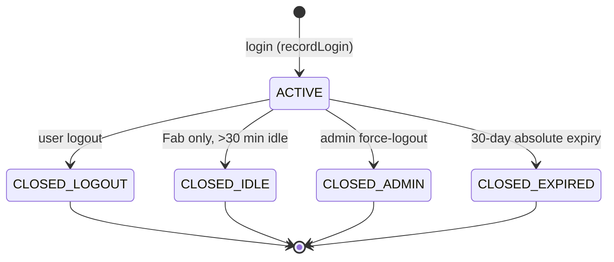

# 6 — Error & Recovery Matrix

> Version: commit `7976c78` on `main`. See [README](./README.md).
> Validation: 🔵 Static. Consolidates the failure modes seen across the scenario traces and
> the FabOrch error subsystem.

---

## 6.1 The canonical error catalog (REQ-01)

Every handled error resolves to one of **10 canonical types** (`lib/errors/*`), each with a
priority, a user-facing message, and an HTTP status. The runtime source of truth is the
`error_catalog` DB table; a frozen in-code catalog is the fallback.

| Error type | Typical cause | HTTP | Persisted to |
|------------|---------------|:----:|--------------|
| `SESSION_TIMEOUT` | expired/idle/invalid token | 401 | (skipped if unauthenticated) |
| `INVALID_PARAMETER` | Zod failure, bad model, bad tool args | 400 | `error_audit_logs` |
| `NO_ROWS_RETURNED` | Prisma P2025 / empty result | 404 | `error_audit_logs` |
| `MISSING_FILTER` | query missing a required filter | 400 | `error_audit_logs` |
| `SQL_CALL_FAILURE` | DB / Prisma error | 500 | `error_audit_logs` |
| `DDL_DML_REJECTED` | write attempted where read-only expected | 400 | `error_audit_logs` |
| `LAMBDA_MCP_CRASH` | MCP/external tool failure, Anthropic overload | 502/500 | `error_audit_logs` |
| `RESPONSE_TIMEOUT` | 30s tool timeout, aborted stream | 504 | `error_audit_logs` |
| `ROW_CAP_EXCEEDED` | > 1000 rows | 200 + warning header | — |
| `UNLISTED_STORED_PROC` | unknown tool / 404 from MCP | 404 | `error_audit_logs` |

Persistence gets a human id `ERR-YYYYMMDD-NNNN` (atomic via `error_audit_daily_counter`).
Classification (`classifyError`) is **heuristic** (name/message matching) — see
[hotspots §2](./03-review-hotspots.md#2-security--authorization).

## 6.2 Recovery behavior by subsystem

| Subsystem | Failure | Recovery / degradation | Visible to user? |
|-----------|---------|------------------------|------------------|
| **Model registry** | DB read fails | Falls back to hardcoded model list + pricing | No (silent) |
| **Error catalog** | DB read fails | Falls back to frozen in-code catalog | No |
| **Chat: S3 upload** | PutObject fails | Logged; chat continues without the file | Partially |
| **Chat: MCP load** | server unreachable | Tool omitted; chat continues | No |
| **Chat: stream error** | Anthropic overload/timeout | `onError` → error chunk `(errorId=…)` + audit rows | Yes |
| **Chat: client disconnect** | user closes tab | `consumeStream()` finishes backend; audit still written | N/A |
| **MCP tool call** | session expired | `refreshMcpSession` + **one** retry | No (if it recovers) |
| **MCP tool call** | timeout / server error | classified error returned to LLM as `{isError:true}` | Yes (in answer) |
| **CMF load (REST)** | concurrent run | 409; blocked until existing run finishes/expires | Yes |
| **CMF load** | bad row | **entire package rolled back** (atomic) | Yes |
| **CMF load** | poll timeout (AI path) | reported failed — **but commit may still land** | Misleading ⚠️ |
| **CMF token** | Secrets Manager unreadable | `TokenUnavailableError` → run FAILURE / `{ok:false}` | Yes |
| **Audit writes** (all REQ) | DB write fails | fire-and-forget `.catch()` — swallowed | No (CloudWatch only) ⚠️ |
| **Retention purges** | not scheduled | tables grow unbounded until run manually | No ⚠️ |

## 6.3 Session lifecycle states (REQ-02)

- **Fab** evicts on 30-min idle; **Admin** never idle-evicts (but reconciles stale *end-user*
  sessions when an admin queries).

## 6.4 Disaster-recovery / rollback

| Scenario | Mechanism |
|----------|-----------|
| Bad Fab deploy | `swap-environment-cnames` back to `faborchestratorai-prod` |
| Bad Admin deploy | Re-deploy prior application-version to `fab-admin-prod` |
| DB migration issue | Additive SQL is idempotent + apps degrade gracefully when tables absent |
| CMF unreachable | App detects `ENOTFOUND`/`ECONNREFUSED` → "connect to VPN" message; loads fail safely (no commit) |
| Model registry corrupt | Apps fall back to built-in model list/pricing |

> ⚠️ **Not yet verified:** there is no documented automated DR runbook beyond CNAME swap;
> confirm backups/RTO/RPO for RDS with an ops owner. Runtime validation needed.
