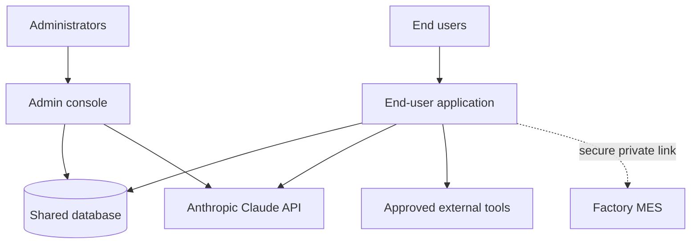

# FabOrchestrator Platform — Overview

> **Audience:** external stakeholders. This document describes the platform's architecture,
> security controls, and operating model at a level suitable for sharing outside the
> engineering team. It contains **no source code, file paths, credentials, internal
> hostnames/IPs, account identifiers, or proprietary algorithms.**

---

## 1. What the platform is

FabOrchestrator is an enterprise AI platform for a manufacturing environment, delivered as
two complementary web applications backed by a single shared database:

- **FabOrchestrator.AI** — the application end users work in. It provides an AI assistant
  (built on Anthropic's Claude models) for conversational analysis, document generation, and
  a guided workflow for preparing and loading manufacturing **master data** into the
  factory's manufacturing execution system (MES).
- **NexusOps AI** — the administrative console. Administrators manage users, roles and
  permissions, the catalog of available AI models and their pricing, tool access, and the
  platform's usage, cost, and audit reporting.

Both applications are built on a modern, standard web stack (server-rendered React with a
TypeScript backend) and run as containers in AWS.

## 2. Core capabilities

| Capability | Description |
|------------|-------------|
| Conversational AI | Streaming responses from Claude models, with document upload and generation |
| Tool integration | The assistant can securely call approved external tools to retrieve live operational data |
| Master-data workflow | A guided, validated process for preparing and loading data into the factory MES |
| Role-based access | Fine-grained control over which users can use which models, tools, and features |
| Usage & cost tracking | Per-user, per-model token and cost accounting |
| Comprehensive auditing | Session, error, and prompt/response audit trails |

## 3. Architecture at a glance

- The two applications **integrate through the shared database**, not by calling each other
  directly. Administrators configure the platform; the end-user application reads that
  configuration and records usage and audit data back.
- Only the end-user application connects to the factory MES, and only over a **secured
  private network link**.

## 4. Security controls

| Control | Approach |
|---------|----------|
| Authentication | Per-application session tokens issued on login; 30-day expiry |
| Passwords | Salted, hashed with a strong key-derivation function; constant-time verification |
| Sensitive data at rest | API keys and tool credentials encrypted with AES-256-GCM |
| Access control | Role-based permissions govern models, tools, and features per user |
| Usage limits | Per-role daily request and token quotas |
| Administrative separation | The admin console rejects non-administrator logins |
| Auditability | Every login/logout, error, and AI prompt/response is recorded with a traceable identifier |
| Secrets management | Runtime credentials are injected from a managed secrets store, never stored in code |
| Session governance | Idle and administrative logout; administrators can force a user's sessions closed |

## 5. Data handling & privacy

- **AI processing:** user prompts and uploaded documents are sent to Anthropic's Claude API
  to generate responses. Uploaded files are held in private, access-controlled storage and
  shared with the AI only via short-lived, time-limited access links.
- **Audit records** retain prompt and response text for accountability, with configurable
  retention and redaction controls in the admin console.
- **Factory data:** master-data loads transmit the prepared data to the MES over the secured
  private link; loads are validated before they are committed and are applied atomically.
- **Access to operational data** through external tools is limited to the tools an
  administrator has explicitly approved for a given role.

## 6. Reliability & error handling

- A **canonical error catalog** maps every failure to a clear, user-appropriate message and a
  traceable identifier, while technical detail is recorded separately for operators.
- The platform is designed to **degrade gracefully**: if optional configuration or an external
  dependency is unavailable, core functionality continues with safe defaults rather than
  failing outright.
- **Master-data loads are validated before commit** and are all-or-nothing, so a partial or
  inconsistent load cannot occur.
- Long-running AI responses stream continuously with keep-alive signalling to remain reliable
  over standard web infrastructure.

## 7. Deployment model

- Both applications run as **containers on AWS**, behind a content-delivery/HTTPS layer.
- The end-user application runs in an isolated network with a secured connection to the
  factory MES; the admin console runs in a separate network with database access only.
- Deployments support **blue/green cutover and rollback**.

## 8. Integrations summary

| Integration | Purpose | Direction |
|-------------|---------|-----------|
| Anthropic Claude API | AI responses | Outbound |
| Factory MES | Master-data validation & load | Outbound (private link) |
| Approved external tools | Live operational data retrieval | Outbound |
| Email (SMTP) | Invitations and password resets | Outbound |
| Managed cloud storage & secrets | File storage, credentials | Internal to cloud |

---

*This overview is a summary. Detailed technical documentation (component inventories,
control-flow traces, and infrastructure specifics) is maintained internally and is available
to the engineering team under the appropriate access controls.*
