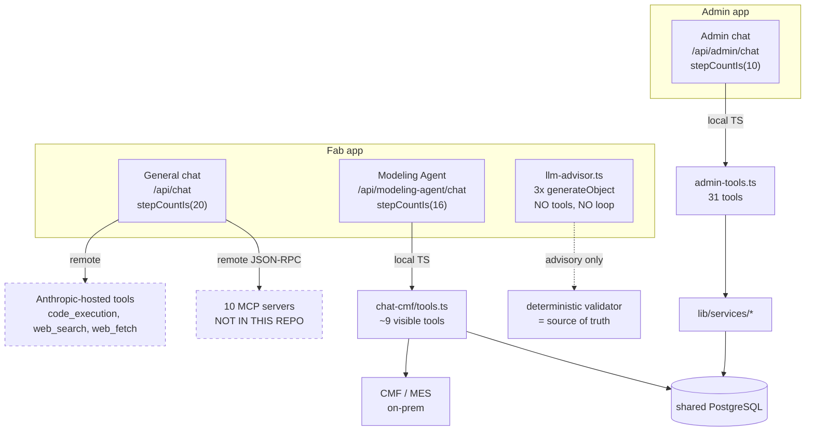

# Agentic architecture — what the agents are and how they're wired

> **Status:** 🔵 **Static** — derived by reading source only. Nothing here is runtime-confirmed.
> **Pinned to:** `abe8706d8ed51709bd316d83783a66e6a8a27f28` (app code verified unchanged at HEAD).
> **No application code was modified.**

## The headline

**Three conversational agents, all the same shape, with no orchestration between them.**
Each is a single-loop, tool-calling agent built on AI SDK v6 `streamText` with a step cap.
There is **no orchestrator, no sub-agents, no agent-to-agent handoff, no planner/critic, no
reflection or retry loop.** Nothing in this system delegates to anything else.

Underneath them sits a second, **non-agentic LLM tier**: three single-shot structured-output
calls used for advisory error explanation during CMF validation.

## There is no file that tells you this

Worth stating plainly, because it shaped how this page was produced. The repo contains **no
architecture document in code, and no shared agent abstraction**. Each route hand-rolls its own
loop, prompt assembly, and toolbelt; the commonality between them is a coincidence of three
files independently doing the same thing, not a shared `createAgent()`.

The only reliable inventory is to find every LLM call site:

```bash
grep -rn "streamText(\|generateText(\|generateObject(" claudeai_athena admin_athena \
  --include=*.ts | grep -v generated
```

That returns **seven results across the whole monorepo**, and they are the entire agentic
surface:

| # | Call site | Kind |
|---|---|---|
| 1 | `claudeai_athena/app/api/chat/route.ts:754` | Agent — general chat |
| 2 | `claudeai_athena/app/api/modeling-agent/chat/route.ts:216` | Agent — Modeling Agent |
| 3 | `admin_athena/app/api/admin/chat/route.ts:104` | Agent — Admin |
| 4 | `claudeai_athena/lib/validation/llm-advisor.ts:111` | Advisory — `explainErrors` |
| 5 | `claudeai_athena/lib/validation/llm-advisor.ts:161` | Advisory — `explainCmfErrors` |
| 6 | `claudeai_athena/lib/validation/llm-advisor.ts:196` | Advisory — `advise` |
| 7 | `claudeai_athena/app/api/user/anthropic/test/route.ts:25` | Health check (one-token API-key test) |

## The three agents

| | **General chat** | **Modeling Agent** | **Admin** |
|---|---|---|---|
| Route | `/api/chat` | `/api/modeling-agent/chat` | `/api/admin/chat` |
| App | Fab | Fab | Admin |
| Model | user-selected, gated by `model_registry` + role | fixed `MODEL` const | `modelId` from request |
| Step cap | `stepCountIs(20)` (`:713`) | `stepCountIs(MAX_STEPS)`, env `CHAT_LLM_MAX_STEPS` default **16** (`:20`, `:221`) | `stepCountIs(10)` (`:110`) |
| System prompt | `lib/system-prompts.ts`, layered + dynamic MCP tool injection | `SYSTEM_PROMPT` const | `ADMIN_SYSTEM_PROMPT` + injected date block (`:91–99`) |
| Tools | `code_execution`, optional `web_search`/`web_fetch`, plus *N* MCP tools | ~9 of 11 (two withheld) | 31 |
| Tool residence | **Remote** | **Local** | **Local** |
| Prompt caching | ✅ (`:610–640`) | ❌ | ❌ |
| Server-side context editing | ❌ | ❌ | ✅ `clear_tool_uses_20250919` (`:114–124`) |
| Per-step message repair | ✅ `prepareStep` → `cleanToolMessages` (`:660`) | ❌ | ❌ |
| Parallel tool use | default | default | disabled (`:113`) |
| RBAC on tools | ✅ MCP filtered by role (`:434–448`) | ❌ | ❌ (single `requireAdmin` on the route) |
| Usage/cost recorded | ✅ | ❌ (see [doc 13 §1](./13-second-pass-findings.md)) | ✅ |

## The most important distinction: where tools run

The "Tool residence" row above is the fact worth carrying into any analysis.

**General chat — tools are remote.** `code_execution` runs in **Anthropic's** sandbox, not on
FabOrchestrator infrastructure. `web_search`/`web_fetch` likewise. And all factory data arrives
through **MCP servers reached over JSON-RPC/HTTPS** — services that are *not in this repo*. On
this surface, Fab is essentially a **thin proxy**: it authenticates, assembles a prompt, picks a
toolset, and streams. It executes almost nothing itself.

**Modeling Agent and Admin — tools are local.** Their tools are ordinary TypeScript functions
running inside the Next.js process, hitting Prisma, the CMF REST client, and the CMF SQL Server
directly. `admin_athena/lib/admin-tools.ts` is 76 KB and *is* the admin write surface;
`claudeai_athena/lib/chat-cmf/tools.ts` is 41 KB and reaches the live factory.

So **"the agent" means two structurally different things** depending on the surface, and nothing
in the code names that distinction.



## The advisory tier — the best-designed part of the system

`lib/validation/llm-advisor.ts` makes three `generateObject` calls: structured output against
Zod schemas, **no tools, no loop, single-shot**. They run inside the CMF validation flow to
translate terse errors into plain-language, located, actionable explanations.

The design property that matters: **the deterministic validator is the source of truth and the
LLM is strictly advisory — it cannot change the verdict.** This is enforced three ways:

1. **In the prompt** — *"A deterministic validator (the source of truth) already found the exact
   errors below… Do NOT invent new errors, change the verdict, or drop any."* (`:120`, `:123`)
2. **In the schema** — output is constrained to explanation fields; there is no verdict field to
   overwrite.
3. **In the failure path** — every call is wrapped so that *any* failure is non-blocking:
   `maxRetries: 1`, an `AbortSignal.timeout(TIMEOUT_MS)`, an early return when
   `ANTHROPIC_API_KEY` is absent, and a `catch` returning `EMPTY_EXPLANATIONS`. If the model is
   slow, down, or unconfigured, the deterministic block still stands on its own.

This is a textbook LLM-in-the-loop pattern — the model adds *explanation*, never *authority* —
and it is worth preserving as the reference example if this pattern is extended elsewhere.

## Two patterns to know before analyzing

### Tool gating is by omission, not by permission

The Modeling Agent withholds its two most dangerous tools by destructuring them out of the
toolbelt (`route.ts:208–214`):

```ts
const {
  previewLoadImpact: _hiddenPreview,
  loadToCmf: _hiddenLoad,
  ...visibleTools
} = buildChatTools(user.id);
```

There is **no authorization check inside `loadToCmf` itself**. The safety property is *"the model
was never told this tool exists,"* not *"the model is forbidden from invoking it."* Re-adding the
key to the object is sufficient to make it live. The same holds generally: tool availability is
decided entirely at assembly time.

### RBAC exists in exactly one of the three agents

Only the general chat performs per-tool authorization — it filters MCP connections against the
caller's role, admitting role-scoped connections plus personal ones when
`role.personalMcpEnabled` (`chat/route.ts:434–448`).

The Modeling Agent has no per-tool authorization. Admin's entire boundary is the single
`requireAdmin` in front of the route — once past it, all 31 tools are reachable.

## What the code does and doesn't explain

**Explains well (local decisions).** The inline comments are genuinely good where they exist:
the prompt-caching block explains *why* caching is disabled when volatile presigned S3 URLs are
in the prefix; the tool-scope comment explains *why* two tools are hidden; `instrumentation.ts`
explains *why* it is a no-op. Someone reasoned carefully and wrote the reasoning down.

**Does not explain (global shape).** There is no architecture doc, no shared agent abstraction,
and no inventory of agents. The per-app `CLAUDE.md` files are actively misleading — they are
**stale**, describe a 7-model / 7-table version of the system, and do not mention the Modeling
Agent or the admin toolbelt at all.

**Practical consequence:** to answer "what agents exist?" you must grep the call sites. There is
no shortcut and no file to read.

## Open questions for the code owners

1. Is the absence of any orchestration deliberate (three independent products) or is convergence
   onto a shared agent runtime intended?
2. Should tool gating move from assembly-time omission to an in-tool authorization check —
   particularly for `loadToCmf`, which commits to the live MES?
3. Should the general chat's MCP RBAC pattern be extended to the other two agents?
4. Is the `llm-advisor` advisory pattern the intended template for future LLM use?

## Related

[13 — Second-pass findings](./13-second-pass-findings.md) ·
[12 — Improvements & underutilized resources](./12-improvements-and-underutilized-resources.md) ·
[11 — MCP server & tool catalog](./11-mcp-server-catalog.md) ·
[04 — Architecture & integration](./04-architecture-and-integration.md) ·
[03 — Review hotspots](./03-review-hotspots.md)
