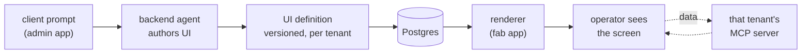
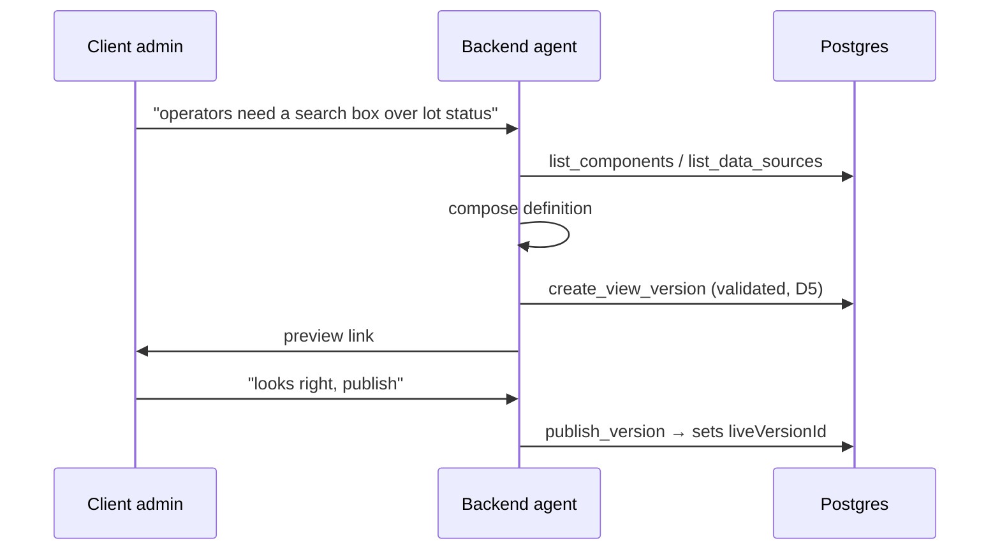
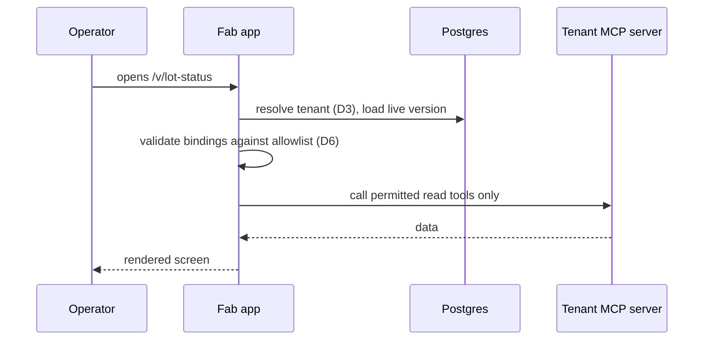

# 16 — Agent-driven UI customization: design plan

> **Status:** 🟠 **Proposal** — a design for review, not a description of existing code.
> Everything here is proposed unless explicitly marked as existing.
> **Baseline:** `abe8706d8ed51709bd316d83783a66e6a8a27f28` (app code unchanged at HEAD `8b304c0`).
> **Prerequisite reading:** [15 — decision brief](./15-ui-customization-decision-brief.md).
> **No application code has been modified.** This document proposes modifying it.

## How to review this

The document is built to be corrected. Two things are numbered so they can be overruled
individually:

- **`D1`–`D8` — design decisions.** Each states a proposal, the reasoning, and the consequence of
  choosing otherwise. **`D1` is the big one**; several others depend on it.
- **`P0`–`P6` — build phases.** Each is independently shippable. They can be reordered or cut,
  except where a dependency is noted.

Where a decision was made on thin evidence, it is marked **⚠️ low confidence** — those are the
ones most worth attention.

---

## 1. What we are building

A client tells the agent what they want their screen to look like. The agent produces it. It
appears in their app, with their live factory data, without a developer and without a deploy.

### The pipeline



**Every stage except one is identical regardless of how UI is expressed.** Tenancy, storage,
versioning, rollback, publishing, data access, and the agent's tools do not change. Only the
*definition format* and the *renderer* do — that is `D1`.

This is deliberate: it keeps `D1` from being a decision that has to be right before work starts.

---

## 2. Design decisions

### D1. What the agent produces — **the decision everything else hangs on**

The agent must express a UI in some format. Two candidates:

| | **(a) Layout spec** | **(b) React source** |
|---|---|---|
| Agent emits | JSON referencing vetted components | Component source code |
| Renderer | Maps spec → real components | Evaluates source in a sandboxed iframe |
| Invalid output | Rejected before saving | Only discoverable by running it |
| Ceiling | What the component library covers | None |
| Data access | Normal app code + normal MCP authorization | Needs a `postMessage` bridge |
| Reuses | `components/ui/*` — table, input, select, tabs, card, badge, chart | Sandpack pipeline (`artifact-parser.ts`, `sandpack-preview.tsx`) |
| Styling | Inherits the tenant theme automatically | Needs styling shipped into the sandbox |

**Proposal: (a) layout spec**, with (b) revisited if real requests exceed the library.

**Reasoning.** The stated requirements are continuous changes, no human approval, a shared
deployment, and operators as primary users. Under (b), unreviewed model-written JavaScript runs
in an app holding other tenants' sessions, and a bad generation reaches an operator with nobody
watching. The safety machinery that makes (b) acceptable is roughly the machinery an approval
gate would have provided. Under (a), an invalid layout cannot be saved, so "no approval" is safe
by construction rather than by review.

The stated examples — a search bar, a small table, operator-facing — sit inside a bounded
vocabulary.

**Under (a), the agent still designs the UI.** It chooses components, arrangement, data, and
labels. It emits a layout instead of source. If the requirement is "the agent builds the UI,"
(a) satisfies it; if the requirement is specifically "the agent emits React," it does not.

> **⚠️ This is the decision to correct if any is wrong.** Choosing (b) changes `D5`, `D6`, and
> `D7`, and adds a sandbox, a data bridge, and a capability model to `P2`. It does not change
> `P0`, `P1`, or the storage design.

### D2. The tenant is a **company**, not a site

`Tenant` owns users, settings, views, and MCP connections. Multi-site customers are represented
by views within one tenant.

**Consequence if wrong:** if sites need separate UIs, MCP servers, and operator populations,
tenancy becomes two-level and every scoped query changes. Cheaper to decide now than later.

> **⚠️ low confidence** — no information yet about whether customers are single- or multi-site.

### D3. Tenant is resolved from the session, with a host fallback for pre-auth

Authenticated requests resolve tenant from `user.tenantId`. The login page needs branding before
a user exists (`providers.tsx:196` fetches the theme pre-auth), so unauthenticated requests
resolve by hostname.

**Consequence:** every tenant needs a hostname (subdomain or custom domain) if pre-auth branding
matters. If it does not, the login page stays generic and this is dropped.

### D4. Existing global settings become per-tenant

`PlatformSettings` (singleton, `id = "global"`) becomes `TenantSettings`, keyed by tenant. The
existing read path (`/api/platform-theme`) and write path (`/api/admin/settings/theme`) keep
their shapes and gain tenant scoping.

**Reasoning:** reuses a working end-to-end path rather than building a parallel one.

### D5. UI definitions are versioned; publishing points a pointer

A `UiView` has many `UiViewVersion` rows. The view holds `liveVersionId`. Publishing updates that
pointer; rollback points it back. Versions are immutable.

**Reasoning:** with no approval gate, rollback is the primary safety mechanism, so it must be
instant and total. A pointer swap is both.

### D6. A view declares the data it may reach; the runtime enforces it

Each version carries explicit data bindings — which MCP tool, on which connection, with which
parameters. The runtime calls only those.

This adds a **second gate** on top of the existing per-connection role filter
(`chat/route.ts:432-447`), which authorizes *connections* but not *individual tools*.

**Reasoning:** MCP servers can expose write tools. Without a per-view allowlist, a generated
screen could invoke a write against a live MES.

### D7. Generated UI is read-only in v1

Bindings are restricted to read tools. Actions are out of scope until `P6`.

**Consequence if wrong:** if operators must *act* from generated screens, `P6` moves earlier and
needs a confirmation-and-audit design of its own.

> **⚠️ Flagged in brief §5 Q4 and still unanswered.**

### D8. Authoring happens in the admin app; rendering in the fab app

The backend agent (`admin_athena`) authors. The fab app renders. They communicate through
Postgres, matching the existing integration pattern — the two apps share a database and make no
direct calls ([doc 04](./04-architecture-and-integration.md)).

---

## 3. Data model

Proposed additions. Existing models referenced in **bold**.

```prisma
model Tenant {
  id        String   @id @default(uuid())
  slug      String   @unique          // URL-safe identifier
  hostname  String?  @unique          // pre-auth branding lookup (D3)
  name      String
  status    String   @default("ACTIVE")
  createdAt DateTime @default(now())

  users    User[]
  views    UiView[]
  settings TenantSettings?
}

model TenantSettings {                // replaces PlatformSettings (D4)
  tenantId     String  @id
  colorTheme   String  @default("fab-blue")
  productName  String?
  logoUrl      String?
  primaryColor String?                // arbitrary brand colour, not the 6-theme enum
  updatedById  String?
  updatedAt    DateTime @updatedAt

  tenant Tenant @relation(fields: [tenantId], references: [id], onDelete: Cascade)
}

model UiView {
  id            String  @id @default(uuid())
  tenantId      String
  key           String                 // route slug, e.g. "line-status"
  name          String                 // operator-facing title
  liveVersionId String?                // null = never published (D5)
  createdById   String
  createdAt     DateTime @default(now())

  tenant   Tenant          @relation(fields: [tenantId], references: [id], onDelete: Cascade)
  versions UiViewVersion[]

  @@unique([tenantId, key])
}

model UiViewVersion {
  id           String   @id @default(uuid())
  viewId       String
  version      Int                     // monotonic per view
  format       String                  // "spec" | "react"  (D1)
  definition   String   @db.Text
  dataBindings Json     @default("[]") // allowlist (D6)
  createdById  String
  createdAt    DateTime @default(now())

  view UiView @relation(fields: [viewId], references: [id], onDelete: Cascade)

  @@unique([viewId, version])
}
```

Plus `tenantId` on **User**, **McpConnection**, and **Role**.

**Deliberately not reusing `Artifact`.** It requires `conversationId` and `messageId` with
`onDelete: Cascade` (`schema.prisma:150`) — a published UI would be deleted when its chat was
tidied up.

### The `format` field is the seam

`D1` is recorded per version rather than assumed globally. Choosing (b) later, or supporting both,
means adding a renderer — not migrating data.

---

## 4. Runtime flows

### Authoring



### Rendering



**Failure behaviour (`D5`/`P5`):** if a version fails to render, the runtime falls back to the
previous live version and records the failure. Operators keep a working screen; nobody has to be
watching.

---

## 5. Build phases

Sizes are **relative** (S / M / L), not estimates.

### P0 — Tenancy foundation · **L** · blocks everything

- `Tenant` model; `tenantId` on `User`, `McpConnection`, `Role`
- Backfill existing data into a single default tenant
- Tenant resolution: session, plus hostname for pre-auth (`D3`)
- Scope every existing query — **the bulk of the work and the main risk**
- `PlatformSettings` → `TenantSettings` (`D4`)

**Done when:** two tenants coexist with separate users, MCP connections, and themes, and neither
can see the other's data.

> No user-visible change. Worth stating plainly, because it is the largest phase.

### P1 — Prove the loop · **S** · depends on P0

Give the backend agent tools over the settings that now exist per tenant: theme, product name,
logo, brand colour.

**Done when:** a client admin types *"call us AcmeFab and use our green"* and their operators see
it, with no developer involved.

**Why this phase exists:** it exercises the entire chain — prompt understood, decision recorded,
tenant scoped, app updated — using a path that already works end to end (`D4`). If anything about
the model is wrong, it surfaces here, cheaply.

### P2 — Definition store and renderer · **M–L** · depends on P0

- `UiView` / `UiViewVersion`
- Renderer route in the fab app (`/v/[key]`)
- **Under `D1`(a):** component vocabulary and spec validator
- **Under `D1`(b):** sandboxed evaluator, error isolation, styling into the sandbox

**Done when:** a hand-written definition renders as a working screen for one tenant. Static data
only — no MCP yet.

### P3 — Agent authoring · **M** · depends on P2

Agent tools: `list_views`, `list_components`, `create_view`, `update_view`, `preview_view`,
`publish_view`, `rollback_view`. Validation runs before any version is saved (`D5`).

**Done when:** the agent creates and publishes a working screen from a prompt.

### P4 — Live data · **M** · depends on P3, `D6`

- Data bindings on versions
- Runtime resolves bindings through that tenant's MCP connections
- Per-view tool allowlist enforced on top of the existing connection filter
- Read tools only (`D7`)

**Done when:** a generated screen shows real factory data, and a binding outside the allowlist is
refused.

### P5 — Safety and operations · **M** · depends on P4

- Render-failure fallback to previous live version
- Client-facing version history and one-click rollback
- Audit entries for publish and rollback, reusing `AuditLog`
- Telemetry: render failures, binding denials, publish frequency

**Done when:** a deliberately broken version does not take an operator's screen down.

> With no approval gate (`D7` context), this phase is what replaces human review. It should not
> be deferred past P4.

### P6 — Actions · **M** · optional, depends on `D7`

Write-capable MCP tools from generated UI, with confirmation and audit.

**Only if operators must act from generated screens.**

---

## 6. What this reuses

Reducing the apparent scope:

| Need | Already exists |
|---|---|
| Client MCP portal | `McpConnection`, `/api/mcp/connections`, `/discover`, `/test`, `mcp-add-dialog.tsx` |
| MCP invocation + auth | `lib/mcp-client.ts`, role filter at `chat/route.ts:432-447` |
| Agent framework + tool pattern | `admin_athena/lib/admin-tools.ts` (31 tools) |
| Theme storage → read → apply | `PlatformSettings` → `/api/platform-theme` → `providers.tsx:196` |
| Component vocabulary (`D1`a) | `components/ui/*` — table, input, select, tabs, card, badge, chart |
| Sandboxed React rendering (`D1`b) | `artifact-parser.ts`, `sandpack-preview.tsx`, `sandpack-deps.ts` |
| Audit | `AuditLog` + `recordAuditLog` |

**Not reusable:** `Artifact` (conversation-scoped, §3), and the deploy pipeline — there is none;
deploys are manual ([doc 05](./05-deployment-and-ci.md)). This design avoids needing one.

---

## 7. Risks

| Risk | Mitigation |
|---|---|
| **P0 query scoping misses a path** → cross-tenant data exposure | Enforce at the data-access layer rather than per call site; test with two tenants from day one |
| **Bounded vocabulary proves too narrow** (`D1`a) | `format` field (§3) allows adding a renderer without migrating; track which requests the library cannot express |
| **Unreviewed generation breaks an operator screen** | P5 fallback + rollback; under `D1`(a), invalid definitions cannot be saved |
| **MCP server slow or down** → screen hangs | Per-binding timeouts, partial render, explicit error states — the advisory tier ([doc 14](./14-agentic-architecture.md)) is a good in-repo precedent |
| **Generated UI reaches a write tool** | `D6` allowlist + `D7` read-only in v1 |
| **P0 delivers nothing visible** and loses support | P1 immediately after, deliberately small and demonstrable |

---

## 8. Open questions for Jothi

1. **`D1` — layout spec or React source?** Everything else is stable either way; this sets cost and risk.
2. **`D2` — is a tenant a company or a site?** Determines whether tenancy is one level or two.
3. **`D7` — must operators act from generated screens, or only view?** Moves `P6` in or out.
4. **Is the Modeling Agent (CMF) surface in scope?** It is single-factory ([15 §2](./15-ui-customization-decision-brief.md#2-two-data-planes--only-one-is-single-client)) and does not fit this model without separate work.
5. **Does pre-auth branding matter enough to require per-tenant hostnames (`D3`)?**
6. **Is `P0` acceptable as a first phase**, given it is the largest and delivers nothing visible?

---

## 9. Scope note

This repo is under a **documentation-only constraint** (`CLAUDE.md`): docs pinned to `abe8706`,
application code unmodified, two logged exceptions. **This plan proposes substantial application
changes.** Proceeding requires explicitly lifting that constraint.

---

## Related

[15 — UI customization decision brief](./15-ui-customization-decision-brief.md) ·
[14 — Agentic architecture](./14-agentic-architecture.md) ·
[11 — MCP server & tool catalog](./11-mcp-server-catalog.md) ·
[05 — Deployment & CI](./05-deployment-and-ci.md) ·
[04 — Architecture & integration](./04-architecture-and-integration.md)
