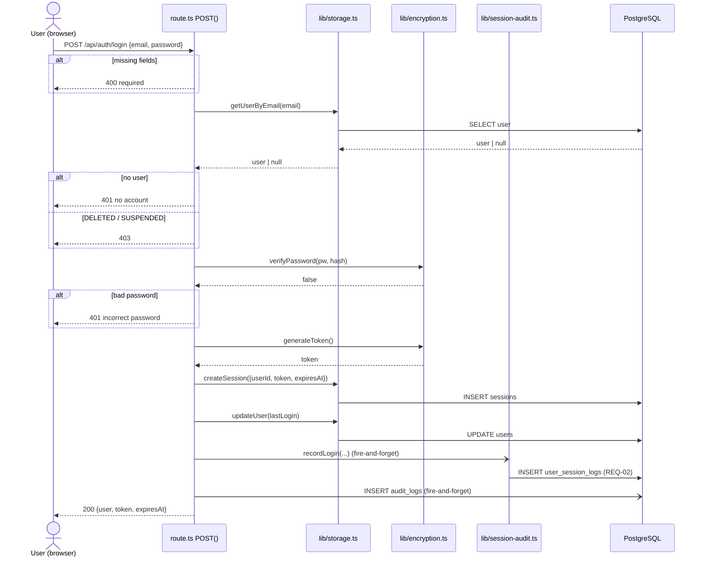
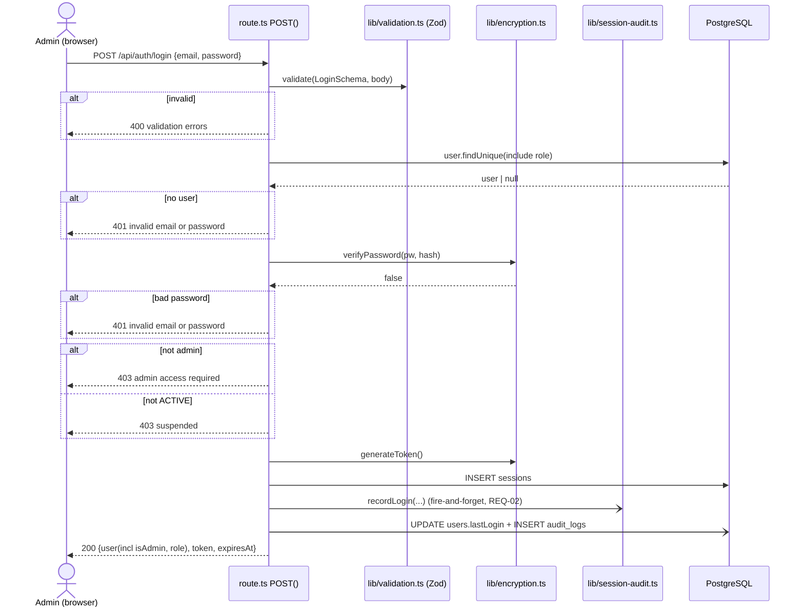

# Scenario 01 — Login (end-to-end trace)

> Version: commit `7976c78` on `main`. See [README](../README.md).
> **Validation: 🔵 Static** (traced by reading code; not yet runtime-validated or
> developer-confirmed).

Both apps have their **own** login endpoint at the same path (`POST /api/auth/login`),
with the same shape but **different rules**. This document traces each, then contrasts
them. Use this as the **template** for tracing every other scenario.

---

## 1. Entry points

| App | Entry point (URL) | File | Function | Trigger |
|-----|-------------------|------|----------|---------|
| Fab | `POST /api/auth/login` | `claudeai_athena/app/api/auth/login/route.ts` | `POST(req)` | User submits the login form |
| Admin | `POST /api/auth/login` | `admin_athena/app/api/auth/login/route.ts` | `POST(req)` | Admin submits the login form |

**Note on architecture:** These are Next.js **App-Router route handlers**. A file named
`route.ts` exporting a function named after an HTTP verb (`POST`) *is* the endpoint —
there is **no separate controller/service/repository layering** like the assignment's
generic example. The route handler calls small helper functions directly. Document the
real (flatter) shape, not the assumed one.

---

## 2. Fab login — control flow

**File:** `claudeai_athena/app/api/auth/login/route.ts`

```text
User submits {email, password}
      ↓
POST /api/auth/login  →  POST(req)                         [route.ts]
      ↓
manual presence check: !email || !password                → 400 "Email and password are required"
      ↓
getUserByEmail(email)                                       [lib/storage.ts → prisma.user.findUnique]
      ↓
user == null                                                → 401 "No account found with this email…"
user.status == 'DELETED'                                    → 403 "This account has been removed…"
user.status == 'SUSPENDED'                                  → 403 "This account has been suspended…"
      ↓
verifyPassword(password, user.passwordHash)                 [lib/encryption.ts → scrypt + timingSafeEqual]
      ↓
isValid == false                                            → 401 "Incorrect password…"
      ↓
generateToken()                                             [lib/encryption.ts → 32 random bytes, hex]
expiresAt = now + 30 days
createSession({userId, token, expiresAt})                   [lib/storage.ts → prisma.session.create]   ⟵ DB write
      ↓
updateUser(user.id, {lastLogin: now})                       [lib/storage.ts → prisma.user.update]        ⟵ DB write
      ↓
recordLogin({userId, sessionToken, loginIp, loginUserAgent})   [lib/session-audit.ts]  (fire-and-forget) ⟵ REQ-02, raw SQL INSERT into user_session_logs
      ↓
prisma.auditLog.create(action: 'user.login')                (fire-and-forget)                             ⟵ DB write, audit_logs
      ↓
200 { user:{id,email,name,avatarUrl,preferences}, token, expiresAt }
```

**Uncaught exception anywhere above** → `catch` → `500 "Failed to login"`.

### Function reference (Fab)

| Function | File | Purpose | Returns | Side effects |
|----------|------|---------|---------|--------------|
| `POST(req)` | `app/api/auth/login/route.ts` | The endpoint | `Response` (JSON) | orchestrates below |
| `getUserByEmail(email)` | `lib/storage.ts` | Look up user | `User \| null` | DB read |
| `verifyPassword(pw, hash)` | `lib/encryption.ts` | scrypt compare, timing-safe | `Promise<boolean>` | none |
| `generateToken(len=32)` | `lib/encryption.ts` | Random session token | `string` (hex) | none |
| `createSession({...})` | `lib/storage.ts` | Persist 30-day session | `Session` | DB write → `sessions` |
| `updateUser(id, data)` | `lib/storage.ts` | Update `lastLogin` | `User \| null` | DB write → `users` |
| `recordLogin({...})` | `lib/session-audit.ts` | REQ-02 session-audit row | `Promise<string>` (log id) | DB write → `user_session_logs` (raw SQL) |

---

## 3. Admin login — control flow

**File:** `admin_athena/app/api/auth/login/route.ts`

```text
Admin submits {email, password}
      ↓
POST /api/auth/login  →  POST(req)                          [route.ts]
      ↓
validate(LoginSchema, body)                                 [lib/validation.ts → Zod]
error                                                        → 400 formatValidationErrors(error)
      ↓
prisma.user.findUnique({where:{email}, include:{role:true}})   ⟵ direct Prisma (no storage wrapper)
      ↓
user == null                                                → 401 "Invalid email or password"   (generic — see §5 Security)
      ↓
verifyPassword(password, user.passwordHash)                 [lib/encryption.ts]
isValid == false                                            → 401 "Invalid email or password"
      ↓
!user.isAdmin                                               → 403 "Admin access required…"       ⟵ KEY DIFFERENCE vs Fab
user.status != 'ACTIVE'                                     → 403 "Account is suspended…"
      ↓
generateToken(); expiresAt = now + 30 days
prisma.session.create({userId, token, expiresAt, userAgent, ipAddress})                            ⟵ DB write, sessions
      ↓
recordLogin({userId, sessionToken, loginIp, loginUserAgent})   (fire-and-forget)                   ⟵ REQ-02
      ↓
prisma.user.update(lastLogin)      (fire-and-forget)                                                ⟵ DB write, users
prisma.auditLog.create(action:'user.login')   (fire-and-forget)                                     ⟵ DB write, audit_logs
      ↓
200 { user:{id,email,name,isAdmin,role}, token, expiresAt }
```

**Uncaught exception anywhere above** → `catch` → `500 "Internal server error"`.

---

## 4. Branch / status-code matrix

| Condition | Fab response | Admin response |
|-----------|--------------|----------------|
| Missing / malformed credentials | `400` (manual check) | `400` (Zod `LoginSchema`) |
| No such user | `401` **"No account found with this email"** | `401` **"Invalid email or password"** |
| Wrong password | `401` "Incorrect password…" | `401` "Invalid email or password" |
| Account `DELETED` | `403` | *(n/a — treated as not-found / not-active)* |
| Account `SUSPENDED` / not `ACTIVE` | `403` | `403` |
| **Not an admin** | *(allowed to log in)* | **`403` "Admin access required"** |
| Valid | `200` + token + user | `200` + token + user (incl. `isAdmin`, `role`) |
| Unhandled error | `500` "Failed to login" | `500` "Internal server error" |

---

## 5. Security & data-flow notes (assignment Task 12)

- **Who can call it:** anyone (both endpoints are public/unauthenticated — that's the point of login).
- **Authentication mechanism produced:** a random 32-byte hex **bearer token** persisted
  in the `sessions` table with a **30-day** absolute expiry. There are **no cookies** — the
  client stores the token in `localStorage` and sends it as `Authorization: Bearer <token>`
  on later calls (validated by `lib/auth-middleware.ts`, traced in a later scenario).
- **Password handling:** compared with `verifyPassword` → Node `crypto.scrypt` + **`timingSafeEqual`**
  (constant-time, resists timing attacks). Plaintext passwords are never stored or logged.
- **Data sent to Anthropic/Claude:** none. Login touches only the local database.
- **⚠️ User-enumeration difference (security-relevant finding):** Fab returns a
  *specific* "No account found with this email" (reveals whether an email is registered),
  while Admin returns a *generic* "Invalid email or password" (does not). The Admin
  behaviour is the safer pattern; Fab's is a mild information-disclosure worth flagging to
  a code owner. **Documented as an observation, not changed.**
- **Logs / audit created on success:** (1) `sessions` row; (2) `user_session_logs` row via
  `recordLogin` (**REQ-02** session audit); (3) `audit_logs` row `action='user.login'`.
  The last two are **fire-and-forget** (`.catch()`), so an audit-write failure does **not**
  block login.
- **Client IP** is derived from `x-forwarded-for` (first hop) / `x-real-ip` — correct
  behind the ALB/CloudFront proxy chain.

---

## 6. Sequence diagram — Fab login (Mermaid)



## 7. Sequence diagram — Admin login (Mermaid)



---

## 8. Key differences (Fab vs Admin) — carry these into the integration section

| Aspect | Fab (`claudeai_athena`) | Admin (`admin_athena`) |
|--------|--------------------------|------------------------|
| Input validation | Manual `if (!email \|\| !password)` | Zod `LoginSchema` + `formatValidationErrors` |
| Data access | Wrapper helpers in `lib/storage.ts` | Direct `prisma.*` calls |
| Admin gate | None — any active user may log in | **Rejects non-admins with 403** |
| Error messaging | Specific (reveals account existence) | Generic (no enumeration) |
| Session store | `sessions` table + `localStorage` bearer | Same |
| Session audit | `recordLogin` → `user_session_logs` (REQ-02) | Same |

---

## 9. Open validation items (for the sign-off tracker)

- [ ] 🟢 Runtime-validate both flows: log in, inspect `sessions`, `user_session_logs`, `audit_logs` rows.
- [ ] ✅ Code-owner confirm: is the Fab "No account found" message intentional, or should it be generic (enumeration)?
- [ ] ✅ Confirm Fab has no admin/role gate at login by design (permissions enforced later, per-route).
- [ ] Confirm `LoginSchema` shape in `admin_athena/lib/validation.ts` (min length, email format).
