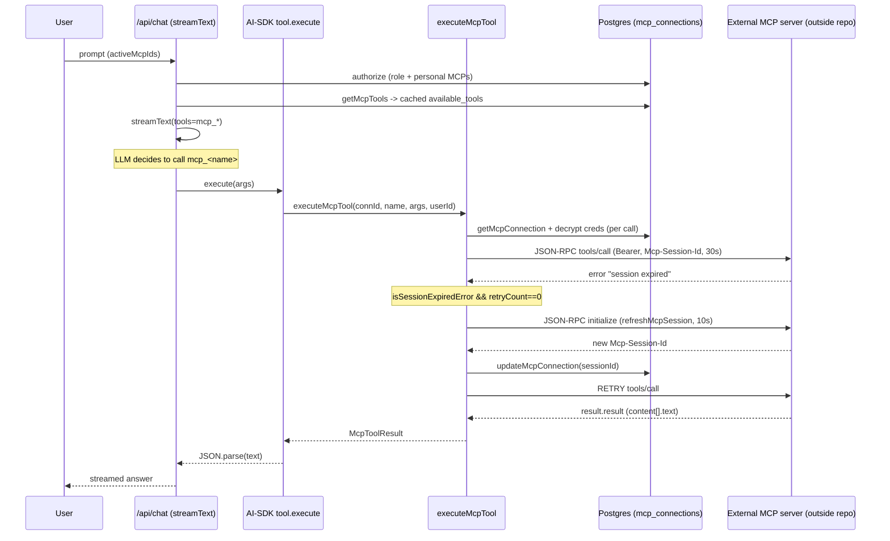

# Scenario 03 — One MCP Tool Invocation

> Version: commit `7976c78` on `main`. See [README](../README.md).
> **Validation: 🔵 Static** — source reading only. The external MCP server's behavior and
> the LLM's tool choice are inferred, not observed.

> **Key scope fact:** this repo contains only the **client** half. The actual MCP **server**
> (the tool implementations) lives **outside this repo** — see
> [scope §0.2](../00-phase-0-scope-and-inventory.md#02-scope-reconciliation).

---

## 1. Entry points

| Flow | HTTP entry | File | Key function |
|------|-----------|------|--------------|
| Tool discovery (manual) | `POST /api/mcp/connections/[id]/discover` | `app/api/mcp/connections/[id]/discover/route.ts` | inline `POST` → `tools/list` |
| Connection test + auto-discovery | `POST /api/mcp/connections/[id]/test` | `app/api/mcp/connections/[id]/test/route.ts` | inline `POST` → `initialize` then `tools/list` |
| Runtime tool execution (from chat) | `POST /api/chat` | `app/api/chat/route.ts` | `loadActiveMcpToolsWithDescriptions` → AI-SDK tool → `executeMcpTool` [`lib/mcp-client.ts`] |

All gated by `requireAuth`; discover/test additionally check ownership (`connection.userId === user.id`).

---

## 2. Control flow

### Discovery → cache
1. `.../test` sends JSON-RPC `initialize` (`protocolVersion 2024-11-05`, `clientInfo.name "llmatscale-ai"`), captures `Mcp-Session-Id` header, persists `{status:'connected', sessionId}`.
2. Then fires `tools/list`, stores result into `mcp_connections.available_tools`.
3. `.../discover` re-runs `tools/list` (requires `status==='connected'`), overwrites `availableTools`.
4. `parseResponse` branches on content-type: JSON → `.json()`; `text/event-stream` → last `data:` line.

### Chat load → authorize → convert
5. `POST /api/chat` reads `activeMcpIds`.
6. **Authorization filter:** `mcpConnection.findMany` for role-level (`roleId===role.id AND userId===null`) + personal (`userId===user.id`, only if `role.personalMcpEnabled`); requested IDs intersected → `authorizedMcpIds`; unauthorized dropped silently.
7. `loadActiveMcpToolsWithDescriptions` → `getMcpTools(connectionId)` reads **cached** `availableTools` (no network) if `status==='connected'`.
8. `convertMcpToolsToAiTools` builds one AI-SDK `tool()` per MCP tool: key = `mcp_<name>` (sanitized); `buildZodSchema(inputSchema)` builds a dynamic Zod object; each `execute` closure calls `executeMcpTool`.

### Runtime execution — `executeMcpTool` [`lib/mcp-client.ts`]
9. LLM emits `mcp_<name>` tool call → `execute` → `executeMcpTool`.
10. Reload connection; reject if missing / not connected. Inner `executeWithRetry(retryCount)`:
    - `getAuthHeaders`: JSON headers + `Mcp-Session-Id` + **decrypt credentials at call time** (`decrypt(authCredentialsEncrypted)`); `api_key` → `Authorization: Bearer <key>`.
    - `fetch(serverUrl, POST)` JSON-RPC `tools/call`, `AbortSignal.timeout(30000)`.
    - `parseSSEResponse` (JSON or SSE).
11. **Session refresh + retry:** on `!ok` / JSON-RPC error / exception, `isSessionExpiredError(text)` matches substrings; if matched **and `retryCount===0`**, `refreshMcpSession` re-runs `initialize` (10s), stores new `sessionId`, retries once.
12. Success → `result.result`; the closure flattens `content[].text`, `JSON.parse` (fallback `{data,success:true}`), returns to LLM.

## 3. Branch / error matrix

| Condition | Retry? | FabOrch error |
|-----------|--------|---------------|
| `fetch` aborts at 30s (`AbortError`/`TimeoutError`) | no | `RESPONSE_TIMEOUT` |
| Session-expiry text | yes (refresh + 1 retry) | none if it recovers; else classified below |
| HTTP ≥ 500 | no | `LAMBDA_MCP_CRASH` |
| HTTP 404 | no | `UNLISTED_STORED_PROC` |
| HTTP 400 | no | `INVALID_PARAMETER` |
| Other non-OK HTTP | no | `LAMBDA_MCP_CRASH` |
| JSON-RPC `-32601` (method not found) | no | `UNLISTED_STORED_PROC` |
| JSON-RPC `-32602` (invalid params) | no | `INVALID_PARAMETER` |
| Other JSON-RPC error | no | `LAMBDA_MCP_CRASH` |
| Generic thrown (network/DNS/parse) | no | `LAMBDA_MCP_CRASH` |

Each error is logged (`logger.fabOrchError`) and persisted via `recordError` (fire-and-forget). The LLM sees `{isError:true, error:"<userMessage> (errorId=<uuid>)"}`. Messages resolve at runtime from the `error_catalog` DB table, with the frozen catalog as fallback.

## 4. Security & data-flow notes

- **Credentials decrypted per call**, never cached in plaintext (AES-256-GCM via `KEY_ENCRYPTION_SECRET`). A decrypt failure is **swallowed** and the request proceeds **without** the auth header.
- **Sent to the external server:** the JSON-RPC `tools/call` envelope with `toolName` + LLM-generated `arguments` (only shape-validated by Zod, not content-sanitized), plus `Bearer` + `Mcp-Session-Id` headers.
- **Ownership vs runtime authz diverge:** discover/test enforce per-user ownership; the chat path enforces role-based access.
- **Shared session state:** `sessionId` lives on the single `mcp_connections` row — a role-level connection shared across users shares one session; `refreshMcpSession` rewrites it globally.
- **The MCP server is outside this repo** (hence the `LAMBDA_MCP_CRASH` naming — the backend is a Lambda/MCP process).

## 5. Mermaid sequence diagram

## 6. Open validation items (need runtime logs)

- [ ] Which tool the LLM selects and the exact `arguments` — needs chat logs.
- [ ] Real server behavior: does it return `Mcp-Session-Id`? does its expiry message match the 6 substrings? SSE vs JSON?
- [ ] Session-refresh race under concurrent chats sharing one role-level connection.
- [ ] Silent-drop UX: decrypt failure (proceeds unauthenticated) and unauthorized `activeMcpIds` (dropped, no feedback).
- [ ] `error_catalog` DB values for the MCP error types.
