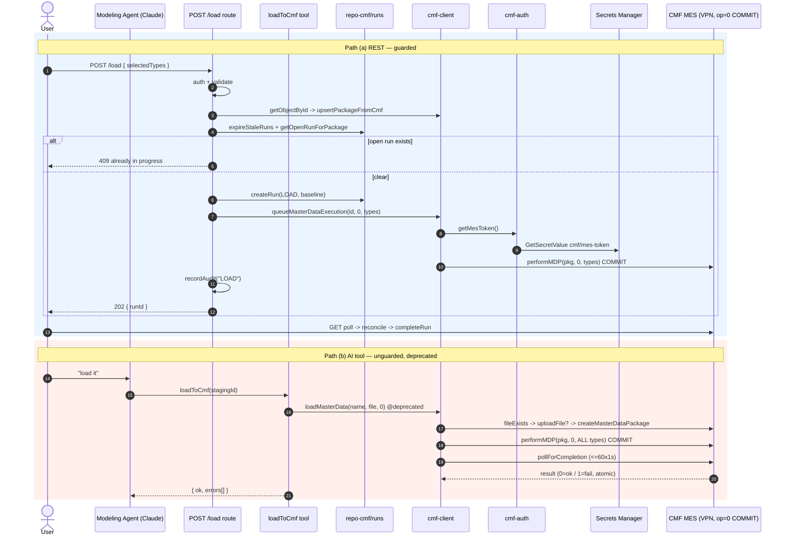

# Scenario 04 — CMF Master-Data Load (⚠️ data-affecting)

> Version: commit `7976c78` on `main`. See [README](../README.md).
> **Validation: 🔵 Static** — traced from source; NOT exercised against a live CMF instance
> or the VPN.

> ## ⚠️ DATA-AFFECTING — LIVE FACTORY MES
> This is the **highest-risk path in the system.** It **commits master data into the live
> Critical Manufacturing (CMF/MES)** over the VPN. The commit uses `ExecutionOperation = 0`,
> which in this deployment is **COMMIT** (op codes are **inverted** vs CMF's nominal docs).
> CMF loads are an **atomic batch**: one bad row rolls back the whole package. There is **no
> application-level undo.**

---

## 1. Entry points — two paths into the same commit

| # | Entry point | Run lifecycle? | Concurrency guard? | Audit? | Underlying commit |
|---|-------------|:--:|:--:|:--:|-------------------|
| (a) | **REST** `POST /api/cmf/packages/[id]/load` `[app/api/cmf/packages/[id]/load/route.ts]` | ✅ `createRun` + reconcile | ✅ partial-unique index (`isOpenRunConflict`) | ✅ `recordAudit("LOAD")` | `performMDP(pkg, 0, selectedTypes)` |
| (b) | **AI tool** `loadToCmf` `[lib/chat-cmf/tools.ts]` | ❌ none | ❌ **none** | ❌ **none** | `loadMasterData(name, file, 0)` (**@deprecated**) |

Both converge on CMF `PerformMasterDataPackage` with `ExecutionOperation = 0`. They differ sharply in **guardrails** (§4, §7).

---

## 2. Control flow

### Path (a) — REST, guarded
1. **Auth** — `getSessionUserId` [`lib/cmf/session.ts`] → `requireAuth`; 401 if none.
2. **Validate** — body must include non-empty `selectedTypes` (else 400).
3. **Resolve package** — `getObjectById(id)` [`cmf-client.ts`] → `upsertPackageFromCmf` [`repo-cmf/packages.ts`] mirrors it locally.
4. **Concurrency guard** — `expireStaleRuns()` (>15 min → EXPIRED) → `getOpenRunForPackage` (409 if open) → `createRun({operation:"LOAD", cmfBaselineEndDate})`; a same-instant duplicate loses the DB **partial-unique-index** race → P2002 → `isOpenRunConflict` → 409.
5. **MES token** (lazy, inside the client) — `getMesToken()` [`cmf-auth.ts`] reads a cached Bearer JWT from AWS Secrets Manager (`cmf/mes-token`), refreshes near expiry; `TokenUnavailableError` if unreadable.
6. **Queue commit** — `queueMasterDataExecution(id, 0, selectedTypes)`: re-fetch for fresh concurrency stamps → `performMDP(fresh, 0, types)` (`ExecutionOperation:0`, `IsToPerformImmediate:true`). Returns immediately; CMF processes async. On throw → `failRun`.
7. **Audit** — `recordAudit("LOAD", {...})` [`cmf/audit.ts`].
8. **Respond** — `202 { runId, queued:true }`.
9. **Completion (out of band)** — client polls `GET /api/cmf/packages/[id]` → `reconcileRunFromCmf`: when CMF's `LastExecutionEndDate` advances past the baseline, `decideRunCompletion` → `completeRun` + stamp package; a successful LOAD calls `markFlowLoaded`. **The load route never closes the run itself** — completion is reconcile-driven; if nobody polls, the run only ever EXPIREs.

### Path (b) — AI tool, unguarded
1. **Scope** — `getStagedUpload(stagingId, userId)` [`repo-cmf/validation.ts`] (user-scoped); no route-level re-auth beyond the chat endpoint.
2. **Load bytes** — reads app-owned `StagedUpload` (never CMF), wraps as a File-like object.
3. **Commit** — `loadMasterData(name, fileObj, 0)` (**@deprecated**): `prepareMasterData` (`sha256Upper` → `fileExists` → `uploadFile` if new → `createMasterDataPackage` → `getObjectTypes`) then `executeMasterData(id, 0, ALL objectTypes)` + `pollForCompletion` (≤60×1s). **Auto-loads every detected object type**, not a user-selected subset.
4. **Result** — classifies `result.log` by severity; returns `{ok, errors[:6], warnings[:6]}`.
5. **No Run row, no concurrency guard, no audit, no reconcile.**

### Shared CMF REST sequence
`fileExists` → (`uploadFile` if new) → `createMasterDataPackage` → `getObjectById` (fresh stamps) → `getObjectTypes` → **`performMDP(pkg, 0, types)` = COMMIT** → (`pollForCompletion` on the sync path). All via `authedFetch` (injects `Authorization: Bearer <getMesToken()>`, throws `CmfApiError` on non-2xx).

---

## 3. The inverted op-code warning ⚠️

`ExecutionOperation` [`lib/cmf/types.ts`] is used **inverted** from CMF's nominal semantics:

| op | Meaning here | Effect |
|----|--------------|--------|
| **`0`** | Validate & Load | **COMMITS to the live DB** |
| `1` | Validate only | Reports counts, does **not** persist |

- **Both paths hard-code `0`** (the committing value).
- A refactor "correcting" `0`→`1` to match CMF docs would **silently turn every Load into a no-op** (or a validate into a live commit). **Landmine.**
- `loadMasterData` is `@deprecated` yet `loadToCmf` still uses it, and it **auto-loads all detected object types**.
- **Atomic batch:** any single failed row rolls back the **entire package**.

## 4. Branch / error matrix

| Scenario | Path (a) REST | Path (b) `loadToCmf` |
|----------|---------------|----------------------|
| Not signed in | 401 | chat-endpoint auth only |
| Empty `selectedTypes` | 400 | N/A (uses all) |
| Concurrent run | 409 (pre-check or P2002) | **no guard — can race** |
| Stale run | swept to EXPIRED >15 min | N/A |
| MES token unavailable | `TokenUnavailableError` → `failRun` + friendly | `{ok:false, error}` |
| VPN / network fail | `authedFetch` throws → `failRun` | `{ok:false, error}` |
| CMF non-2xx | `CmfApiError` → `failRun` | `{ok:false, error}` |
| Validation fail / bad row → rollback | surfaced via reconcile, `result=1`, whole package rolled back | `result=1`, rolled back |
| Poll timeout | N/A (fire-and-forget) | throws after ~60s — **but the commit may still land in CMF** |

## 5. Security & data-flow notes

- **MES token** from Secrets Manager (`cmf/mes-token`, us-west-2), cached in-memory, refreshed near expiry; rotated ~45 min by a separate Lambda. IAM needs `secretsmanager:GetSecretValue`.
- **VPN + private-IP host** — reached over VPN by private IP via a custom undici DNS resolver (`HOST_RESOLVER`). Repro requires the VPN.
- **⚠️ TLS-insecure by default** — `CMF_TLS_INSECURE !== "0"` ⇒ `rejectUnauthorized:false`. Cert verification is **disabled unless `CMF_TLS_INSECURE=0`** is set; `setGlobalDispatcher` weakens TLS process-wide.
- **What leaves to the factory:** the full `.xlsx` bytes, its SHA-256, package name, and object types. On commit these become live MES master data.
- **Blast radius:** atomic batch + inverted op-code + deprecated wrapper on the AI path ⇒ one mistaken confirmation or config flip can write (or fail to write) real factory data with no partial-commit safety net.

## 6. Mermaid sequence diagram

## 7. Open validation items

- 🔵 Verify against live CMF (runtime + VPN) that `op=0` really commits.
- ⚠️ Should `execute()` gain a code-level confirmation gate on path (b), since an early or double model call commits without preview?
- ⚠️ Verify CMF serializes concurrent `performMDP` calls (AI vs AI, AI vs REST), or add a shared guard.
- ⚠️ Is `loadToCmf` riding `@deprecated` `loadMasterData` (auto-loads ALL types) intended, versus `prepareMasterData`+`executeMasterData` with a selected list?
- ⚠️ Verify production sets `CMF_TLS_INSECURE=0` with the corp CA.
- 🔵 Verify whether a path-(b) poll timeout can report failure for a load that actually committed.
- 🔵 Verify the UI always GET-polls to completion, since run closure depends on it.
