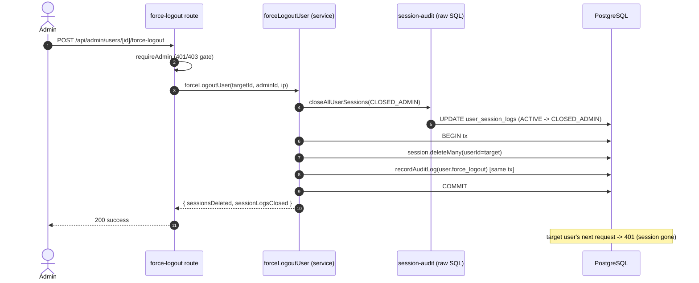

# Scenario 05 — Admin Forces a User to Log Out

> Version: commit `7976c78` on `main`. See [README](../README.md).
> **Validation: 🔵 Static** — traced directly from the route + service + session-audit code.

This scenario shows the admin app's defining pattern: **the audit record is written inside
the same database transaction as the change**, and the **same service function** is reachable
from both a REST route and the admin AI chat.

---

## 1. Entry points — two paths, one service function

| Path | Entry | File | Calls |
|------|-------|------|-------|
| REST | `POST /api/admin/users/[id]/force-logout` | `admin_athena/app/api/admin/users/[id]/force-logout/route.ts` | `forceLogoutUser(id, adminId, ip)` |
| Admin AI chat | force-logout tool | `admin_athena/lib/admin-tools.ts` (invoked via `POST /api/admin/chat`) | same `forceLogoutUser(...)` |

Both call **`forceLogoutUser`** in `lib/services/admin-user-service.ts` — identical behavior whether triggered by a button or by the AI.

---

## 2. Control flow

```
POST /api/admin/users/[id]/force-logout            [force-logout/route.ts]
│
├─[1] requireAdmin(req)                             [lib/auth-middleware.ts]
│      • not a valid session → 401   • not isAdmin / not ACTIVE → 403
│      → { user } (the acting admin)
│
├─[2] id = params.id  (target user)
│
├─[3] forceLogoutUser(id, auth.user.id, getIpAddress(req))   [lib/services/admin-user-service.ts]
│      │
│      ├─[3a] closeAllUserSessions({userId:id, status:'CLOSED_ADMIN', reason:'admin_force'})  [lib/session-audit.ts]
│      │        → raw SQL UPDATE user_session_logs
│      │             SET session_status='CLOSED_ADMIN', logout_time=NOW(), closed_reason='admin_force'
│      │           WHERE user_id=$1 AND session_status='ACTIVE'         ← DB WRITE (REQ-02 close)
│      │        (run OUTSIDE the tx because it's raw SQL; .catch(()=>0) so a failure doesn't block)
│      │
│      └─[3b] prisma.$transaction(tx =>                                 ← ATOMIC
│               • tx.session.deleteMany({ where:{ userId:id } })        ← DB WRITE (kills live sessions)
│               • recordAuditLog(tx, { action:'user.force_logout',
│                     targetType:'User', targetId:id,
│                     metadata:{ sessionsDeleted, sessionLogsClosed }, ipAddress })  ← DB WRITE (audit, SAME tx)
│               return { sessionsDeleted, sessionLogsClosed }
│            )
│
└─[4] 200 { success:true, sessionsDeleted, sessionLogsClosed }   |  catch → 500 "Failed to force logout"
```

**Effect on the target user:** their `sessions` rows are deleted, so their next authenticated
request fails `validateSession` → **401** and they are logged out. Their audit trail shows
`CLOSED_ADMIN`.

---

## 3. Branch / error matrix

| Condition | Response |
|-----------|----------|
| No/invalid admin session | 401 |
| Valid session but not `isAdmin` / not `ACTIVE` | 403 |
| Target user has no active sessions | 200 (`sessionsDeleted: 0`) — idempotent |
| `closeAllUserSessions` raw SQL fails | swallowed (`.catch(()=>0)`); deletion + audit still proceed |
| DB error in the transaction | 500; transaction rolls back (no partial delete, no orphan audit) |

## 4. Security & data-flow notes

- **Who can call it:** admins only (`requireAdmin` enforces `isAdmin` + `status==='ACTIVE'`).
- **Audit is transactional:** the `audit_logs` row and the session deletion commit together —
  you cannot delete sessions without recording who did it (or vice versa).
- **REQ-02 completeness:** the session-audit rows are closed as `CLOSED_ADMIN` *before* the live
  sessions are deleted, so the audit reason is accurate.
- **No data leaves the system;** everything is local DB writes.

> ⚠️ **Reviewer checks (from [hotspots](../03-review-hotspots.md)):**
> - `closeAllUserSessions` targets by `user_id` (Prisma-safe here). The related
>   `reconcileStaleActiveSessions` path matches by `sha256(token)` and filters `is_admin=false`
>   — confirm an admin can't be force-logged-out through that path.
> - The chat-tool path should enforce the same `confirm=true` guard and audit; verify the tool
>   body actually calls `forceLogoutUser` (which audits) rather than deleting sessions directly.

## 5. Mermaid sequence diagram



## 6. Open validation items

- [ ] Confirm the admin-chat force-logout tool routes through `forceLogoutUser` (so it audits) and requires confirmation.
- [ ] Confirm an admin cannot force-logout themselves in a way that locks the console (self-target behavior).
- [ ] Runtime: verify the target actually receives 401 on the next request.
